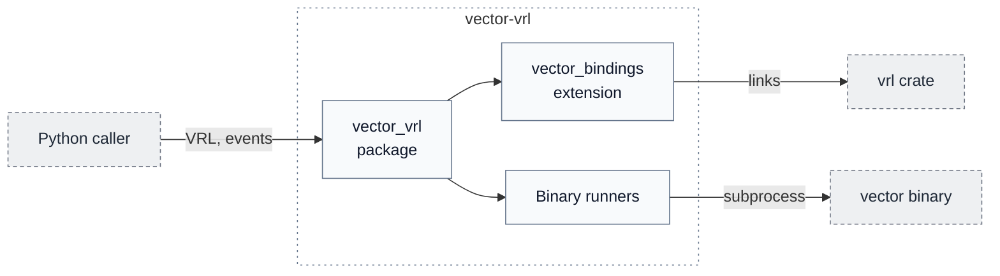

# Architecture

Three components in one checkout, each built and tested from inside its directory. No single venv, lockfile or `pip install -e .` covers the whole tree.

A call goes through the `vector_vrl` package to the compiled extension, which has the `vrl` compiler linked in, or to a `vector` binary the package runs as a subprocess.

*Figure 1. L3 Components -- vector-vrl. Dashed boxes are external.* Up: top of vector-vrl.

| Box | Code |
|---|---|
| `vector_vrl` package | `vector-vrl/src/vector_vrl/__init__.py`, which re-exports the extension, and `config_check.py` |
| `vector_bindings` extension | `vector-bindings/src/`, compiled to a `.so` in `vector-vrl/src/vector_vrl/_bindings/` |
| Binary runners | `validate_config_with_vector` in `config_check.py`, `VectorTestRunner` in `vector_test_utils.py`, and the THG assessor that drives it |

The three components build separately:

| Component | Language | Build | What it does |
|---|---|---|---|
| `vector-bindings/` | Rust (Cargo, PyO3) | `cargo` / `maturin` | Compiles and runs VRL through the `vrl` compiler, and hands the result to Python |
| `vector-vrl/` | Python | maturin, not pip/setuptools | The package that ships to PyPI. It wraps `vector-bindings` |
| `build/` | Python | `uv`, a separate `pyproject.toml` | Tooling that drives the other two and is never imported by them: the [build orchestrator](how-to-run-the-build-orchestrator.md), the Vector version pin, the wheel smoke check |

Dependency runs one way, `vector-bindings` into `vector-vrl`, and `build/` drives both without either depending on it.

`vector-vrl/pyproject.toml` builds through maturin, with `manifest-path` pointing at `../vector-bindings/Cargo.toml`, so installing the Python package always compiles the Rust crate. A plain `pip install .` from a setuptools habit won't do what you expect here.

`vector-bindings` reads no Vector checkout. Its `Cargo.toml` pulls the `vrl` crate straight from https://github.com/vectordotdev/vrl.git, branch `main`. Every entry point in the [Python API](reference-python-api.md) works from a fresh checkout with nothing else cloned.

The orchestrator in `build/` downloads and compiles Vector into a gitignored `vector/` directory at the repo root. Neither `vector-bindings` nor `vector-vrl` reads it. Never edit anything under `vector/`: it's upstream source.

The compiled extension lands in `vector-vrl/src/vector_vrl/_bindings/`. The rest of the package is plain Python, and `validate_config_with_vector` and the binary runners work without the extension.

## What caller-supplied VRL cannot reach

`vector-bindings` restricts the `vrl` crate's features to `stdlib-base` and `enable_crypto_functions`, with `default-features = false`. `vrl`'s default set turns on functions that read the host environment, resolve DNS and make outbound requests, and this crate compiles and runs whatever VRL text a Python caller hands it. So ten functions stay out:

| vrl feature | Functions it would add |
|---|---|
| `enable_env_functions` | `get_env_var` |
| `enable_system_functions` | `encode_proto`, `parse_proto`, `parse_etld`, `validate_json_schema`, `get_hostname`, `get_timezone_name` |
| `enable_network_functions` | `http_request`, `dns_lookup`, `reverse_dns` |

The crate's `full-stdlib` Cargo feature (`full-stdlib = ["vrl/stdlib"]`) turns all ten on for callers who control their VRL source. It's off by default and the published wheel is built without it. The feature's existence pulls `reqwest` and its TLS stack into `Cargo.lock`, because Cargo resolves the lockfile over the union of all features, but a default build links none of it. If you widen the `vrl` feature set, check what it re-enables before you ship it.

A VRL source string can't nest brackets more than 64 levels deep (`MAX_VRL_NESTING_DEPTH` in `nesting.rs`). The VRL parser recurses once per level, unbounded, and deep enough nesting overflows the stack and aborts the process. The count skips string, raw string, regex and timestamp literals and `#` comments, as VRL's lexer does, so a `")"` inside a literal can't hide a level.

Compiling and running happen on a thread with a 256 MiB stack (`VRL_STACK_BYTES` in `lib.rs`), because operator chains with no brackets recurse as deep. Where the process can't reserve that much address space, the work runs on the calling thread instead.

Tests cover each guard: the function list in `vector-bindings/src/lib.rs`, the bracket count in `nesting.rs` and `vector-vrl/tests/unit/test_vector_class.py`, and the VRL stack in `lib.rs`.
