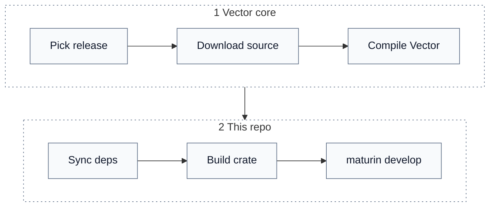

# How to run the build orchestrator

Status: a manual tool. `make` and CI never run it, and its tests (`build/tests/`) cover its helpers, not a full run.

`./build/build` is for when you want Vector itself compiled from source in the same run as this repo. You don't need it for ordinary work: `make check` and `maturin develop` cover that, and `vector-bindings` builds with no Vector checkout at all. Nothing imports it, and it has a separate `pyproject.toml` and `uv.lock`.

The orchestrator compiles a Vector release in one stage, then builds this repo's crate and Python layer in the next.



*Figure 1. L4 Detail -- Build orchestrator. Read each stage left to right, then down.* Up: [vector-vrl documentation](README.md).

| Step | What `build/` runs |
|---|---|
| Pick release | `git ls-remote --tags` on vectordotdev/vector, the two newest releases in turn. When that fails, a fixed list of older releases in `vector_detection.py` |
| Download source | The release tarball into `vector/` at the repo root, else a shallow `git clone` |
| Compile Vector | `cargo build --release --lib` in `vector/` with four features, skipped when a build of the same release under 24 hours old is there |
| Sync deps | Rewrites the `serde_json` line in `vector-bindings/Cargo.toml` to the version in Vector's workspace |
| Build crate | `cargo build --lib` in `vector-bindings/` |
| maturin develop | `uv run maturin develop` in `vector-vrl/`, then a check that the package imports and runs VRL |

A download failure, or a failure the build log classes as an upstream compile error, moves on to the older release. Any other failure stops the run, because the problem is in this repo, not upstream. Exit code is 0 on success, 1 on failure.

The sync step edits a tracked file. Read `git diff vector-bindings/Cargo.toml` after a run before you commit anything.

## Running it

```bash
./build/build
```

The launcher creates `build/.venv` and runs `uv sync` on first use, then runs `build_system.py` from the repo root. To manage the environment yourself:

```bash
uv run --directory build python build_system.py
```

| Flag | Effect |
|---|---|
| `--clean` | Deletes `target`, `.tmp` and `vector` at the repo root, not under `build/`, then builds |
| `--verbose`, `-v` | Sets `VECTOR_VRL_VERBOSE=true`. Setting it yourself does the same |
| `--test-flow` | Runs build detection and release discovery without compiling, plus the dependency sync when a Vector build is there: the cheap check that the orchestrator is wired up |
| `--skip-vector` | Runs stage 2 against an existing Vector build. Exits 1 with `No Vector build found` when there's none |

`--clean` deletes the `vector/` checkout, which is gitignored, so nothing warns you and nothing restores it. The next full run downloads it again.

`build/` is linted and tested with the rest of the repo, from the root:

```bash
make quality-python    # vector-vrl and build
make test-python
```
